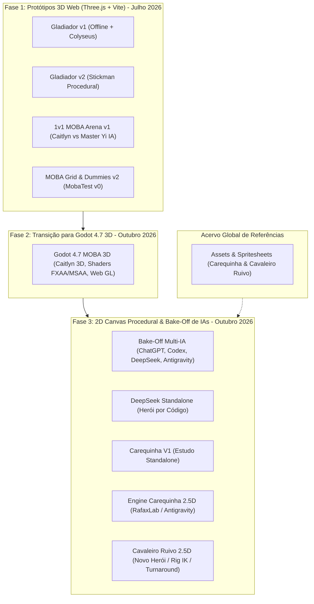

# 🎮 Central de Jogos - Testes & Trajetória 2026

Repositório central e definitivo que unifica, documenta e preserva toda a trajetória de protótipos e testes de jogos desenvolvidos ao longo de 2026 por **Victor Williames**.

Este repositório consolida o histórico que antes estava disperso em múltiplos repositórios (`game-2d`, `game-2d-zero`, `game-x0-moba`, `game-x1`), organizando tudo sem duplicatas, em ordem cronológica e com nomenclatura padronizada:

`[tipo]-[categoria]-[identificador/IA]-[data]`

---

## 🗺️ Visão Geral da Trajetória

---

## 📂 Catálogo dos Projetos

| Pasta | Tecnologia | Foco / Descrição | Data |
| :--- | :--- | :--- | :---: |
| [`game-3D-test-gladiador-v1-threejs-17-07-2026`](./game-3D-test-gladiador-v1-threejs-17-07-2026) | Three.js + Vite + Colyseus | Arena de combate com HUD, life/stamina, dummy e suporte multiplayer. | 17/07/2026 |
| [`game-3D-test-gladiador-v2-stickman-17-07-2026`](./game-3D-test-gladiador-v2-stickman-17-07-2026) | Three.js Puro | Gladiador leve com stickman procedural e texturas dinâmicas. | 17/07/2026 |
| [`game-3D-test-threejs-moba-v1-caitlyn-20-07-2026`](./game-3D-test-threejs-moba-v1-caitlyn-20-07-2026) | Three.js + TS + Vite | MOBA completo: rotas, minions, torres, jungle e IA Caitlyn vs Master Yi. | 20/07/2026 |
| [`game-3D-test-threejs-moba-v2-grid-15-10-2026`](./game-3D-test-threejs-moba-v2-grid-15-10-2026) | Three.js + TS + Vite | Base de mira, projéteis, grid e integração com guias de deploy Godot. | 15/10/2026 |
| [`game-3D-test-godot-moba-18-10-2026`](./game-3D-test-godot-moba-18-10-2026) | Godot 4.7 (GL Compat) | MOBA 3D com Caitlyn, shaders de pós-processamento (FXAA vs MSAA) e Web export. | 18/10/2026 |
| [`game-2D-test-bakeoff-multi-ia-19-10-2026`](./game-2D-test-bakeoff-multi-ia-19-10-2026) | Canvas 2D Nativo | Rodada comparativa de IAs (ChatGPT, Codex, DeepSeek, Antigravity) e relatórios. | 19/10/2026 |
| [`game-2D-test-deepseek-carequinha-20-10-2026`](./game-2D-test-deepseek-carequinha-20-10-2026) | Canvas 2D Nativo | Entrega do modelo e turnaround procedural desenvolvido pelo DeepSeek. | 20/10/2026 |
| [`game-2D-test-carequinha-v1-20-10-2026`](./game-2D-test-carequinha-v1-20-10-2026) | Canvas 2D Nativo | Versão avulsa de testes do motor de combate do Carequinha. | 20/10/2026 |
| [`game-2D-test-antigravity-carequinha-20-10-2026`](./game-2D-test-antigravity-carequinha-20-10-2026) | Canvas 2D Nativo | Motor completo 2.5D do Carequinha, arena isométrica, combos e rig IK. | 20/10/2026 |
| [`game-2D-test-antigravity-ruivo-20-10-2026`](./game-2D-test-antigravity-ruivo-20-10-2026) | Canvas 2D Nativo | Evolução do motor com o novo Cavaleiro Ruivo, turnaround 8 direções e hitboxes. | 20/10/2026 |
| [`assets-referencias-heros-23-10-2026`](./assets-referencias-heros-23-10-2026) | Assets & Imagens | Pranchas de design, poses, rigging e mapas do Carequinha e Cavaleiro Ruivo. | 23/10/2026 |

---

## 🚀 Como Executar os Projetos

A partir da raiz deste repositório, você pode iniciar os servidores locais usando os scripts npm configurados:

### Jogos 3D (Three.js & Vite)
* **Gladiador v1:** `npm run dev:gladiador-v1` -> [http://localhost:5173](http://localhost:5173)
* **Gladiador v2:** `npm run dev:gladiador-v2` -> [http://localhost:5174](http://localhost:5174)
* **MOBA v1 (Caitlyn vs Yi):** `npm run dev:moba-v1` -> [http://localhost:3000](http://localhost:3000)
* **MOBA v2 (Grid Test):** `npm run dev:moba-v2` -> [http://localhost:3005](http://localhost:3005)

### Jogos 2D (HTML5 Canvas Puro)
* **Carequinha (Motor Completo):** `npm run dev:canvas-carequinha` -> [http://localhost:5317](http://localhost:5317)
* **Cavaleiro Ruivo:** `npm run dev:canvas-ruivo` -> [http://localhost:5318](http://localhost:5318)
* **Entrega DeepSeek:** `npm run dev:canvas-deepseek` -> [http://localhost:5319](http://localhost:5319)
* **Carequinha Standalone V1:** `npm run dev:canvas-carequinha-v1` -> [http://localhost:5320](http://localhost:5320)

### Jogo 3D em Godot Engine
* Abra a pasta [`game-3D-test-godot-moba-18-10-2026`](./game-3D-test-godot-moba-18-10-2026) diretamente na **Godot Engine 4.7** e execute a cena principal (`res://scenes/main.tscn`).

---

## 🛡️ Backup & Git

Este repositório está conectado ao GitHub oficial:
**[https://github.com/victorwilliames/GamesTestes2026](https://github.com/victorwilliames/GamesTestes2026)**

O histórico original de cada projeto foi preservado em suas respectivas pastas (`.git-backup`), permitindo que este repositório funcione perfeitamente como um monorepo sem submódulos quebrados.
