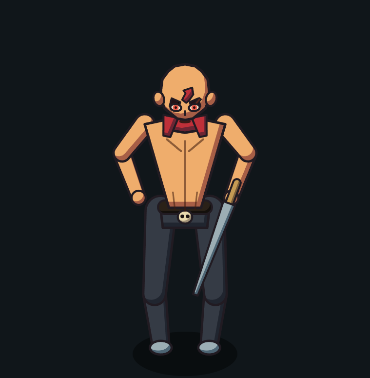

# Protótipo v1 — DeepSeek

Entrega do agente **DeepSeek** para o bake-off descrito em `prototipos/README.md`.
Fase 1 do prompt mestre: o **frame do herói desenhado por código**.



## Como rodar

```bash
cd prototipos/do-deepseek/prototipo-v1-deepseek
node tools/serve.cjs 5317      # servidor local SEM cache
# abra http://localhost:5317/
```

A bancada mostra a prancha do herói + o retrato do rosto, com controles de **ângulo**,
**zoom**, **pose** (parado / golpe 1·2·3) e **fundo** (escuro/claro). Os dois canvases usam
o **mesmo painter**.

## Como testar (sem navegador)

```bash
node --test tests/core.test.cjs tests/rig.test.cjs tests/render.test.cjs
```

Resultado esperado: **8 testes, 8 passam, 0 falham.**

## O que JÁ existe

| Arquivo | Papel |
|---|---|
| `js/core.js` | Câmera isométrica 3/4 (yaw 45°, pitch 34°), vetores, `localPoint`, `unproject`, ruído com semente. |
| `js/ink.js` | Paleta canônica (`Pilot.PAL`) e pincéis HQ: `path`, `celFill` (cel-shading por deslocamento), `hull`, `capsulePath` (cápsula afunilada), `taperPath`. |
| `js/rig.js` | `solveIK` (IK analítica de 2 ossos + vetor polar), `Combat` (combo 1→2→3 com buffer) e `makeRig` (membros + nós do corpo + `swordDir`). |
| `js/head.js` | Cabeça carequinha: elipsoide projetado + olhos rubros, sobrancelhas, marca vermelha, cicatriz, orelhas, nariz e boca — traços só aparecem quando a superfície encara a câmera. |
| `js/hero.js` | Corpo sobre o rig: torso musculoso, calças, lenço, cinto com caveira, espada e cabeça; **ordenação por profundidade**. |
| `index.html`, `styles.css`, `js/studio.js` | Bancada estática (prancha + retrato + controles). |
| `tools/serve.cjs` | Servidor local sem cache na porta 5317 (Node — o `python` do PATH está quebrado). |
| `tests/` | 3 arquivos: projeção, IK/combo/rig e smoke do painter. |
| `artifacts/` | Screenshots reais do protótipo rodando. |

## Crítica honesta (o que ainda está fraco)

Feito por quem escreveu o código — **não** é aprovação artística do usuário.

- **Braços/mãos:** as mãos são blobs e os antebraços ficam meio soltos do tronco. Falta
  dedo/cabo e um pouco de oclusão ombro↔braço.
- **Sobrancelhas:** pesadas demais, quase tapam os olhos.
- **Cicatriz:** lê como uma segunda sobrancelha; precisa ser mais fina e curta.
- **Espada:** guarda/punho pequenos; a lâmina lê como um espeto. Falta um fuller/recorte.
- **Torso:** musculatura muito chapada, sem volume de ombro.
- **Pose parada:** ombros caídos; falta postura mais firme e um leve contrapeso nas pernas.

## O que AINDA NÃO existe

`turnaround.html`, `face.html`, `js/world.js`, `js/fx.js`, `js/main.js`.
Ou seja: **ainda não há WASD, combo jogável nem arena** — o piloto não é jogável ainda.

## Próximo passo

1. Refinar o painter (mãos, sobrancelhas, espada) com o crítico visual.
2. `turnaround.html` (8 direções) e `face.html` (rosto em alta) para inspeção.
3. `world.js` → `fx.js` → `main.js` para o WASD + combo de espada.