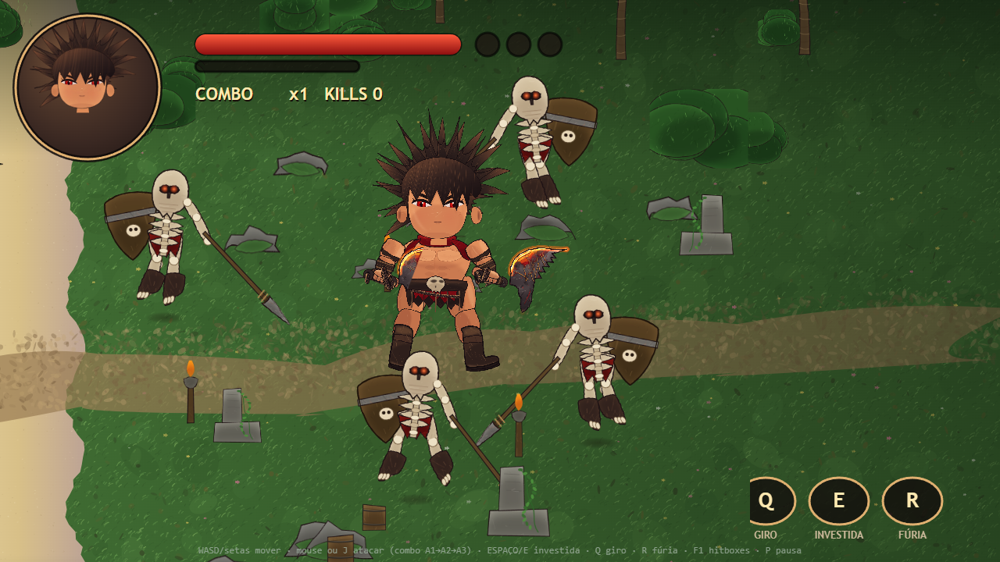

# Lâminas do Caos — herói procedural (DeepSeek)

HERO-02 desenhado **100% por código em Canvas 2D**, com rig, animações, arena, inimigos e combos.
Sem PNG no runtime, sem spritesheets, sem WebGL, sem bibliotecas e sem servidor.

**Abrir:** dê **dois cliques em `index.html`**. Funciona em `file:///` em Chrome/Edge.



---

## Controles

| Tecla | Ação |
|---|---|
| WASD / setas | mover |
| J / Z / clique esquerdo | atacar (combo A1 → A2 → A3) |
| Espaço / E | dash |
| Q | giro de área |
| R | fúria (7 s) |
| F1 | hitboxes |
| P | pausa |
| H | painel de performance |

---

## Estrutura

```
src/
  00-core.js      RNG determinístico, paths, wash/hatch, cache offscreen
  01-head.js      cabeça, rosto, olhos, orelhas, juba
  02-body.js      tronco, cachecol, cinto com caveira, saia
  03-limbs.js     braços, mãos, pernas, botas, bracadeiras
  04-weapon.js    adagas curvas, halo incandescente, cabo, correntes
  05-skeleton.js  constantes do rig, FK, poses
  06-hero.js      montagem, ordem de desenho, arma+mão cacheadas
  07-arena.js     ilha 6000×3800, chão e props
  08-enemy.js     inimigos esqueleto (pintura, IA, dano)
  09-combat.js    golpes, janelas, hitbox da lâmina, FX
  10-game.js      loop, câmera, input, HUD, bancada
tools/
  build.mjs       gera index.html (scripts clássicos inline)
  shell.html      moldura do HTML final
  shot.mjs        captura real via CDP
  eval.mjs        avalia expressão na página (bench)
  perf.mjs        relatório de FPS sustentado
  microtest.html  micro-benchmarks por operação
```

```bash
node tools/build.mjs
```

---

## Parâmetros de inspeção

| URL | Efeito |
|---|---|
| `index.html?debug=1` | hitboxes ligadas |
| `index.html?spawn=8` | 8 inimigos |
| `index.html?sheet=attacks&spawn=0` | folha 3×3 dos ataques |
| `index.html?sheet=hero&spawn=0` | herói ampliado com régua |
| `index.html?freeze=attack:1:0.45&spawn=0` | congela uma pose |
| `index.html?no=ground,props,fx,hud,enemies` | desliga camadas |
| `index.html?bench=8` | 8 s de medição → painel/HUD (`window.__BENCH`) |
| `index.html?benchloop=1` | 100 quadros em laço fechado (`window.__BENCHLOOP`) |

---

## Performance (1280×720, Chrome headless, sem vsync)

| Medição | Resultado |
|---|---|
| Quadro completo, 4 inimigos | **5,425 ms → 184,3 FPS** (suíte final) · já mediu **4,447 ms → 224,9 FPS** |
| Quadro completo, 8 inimigos | **6,104 ms → 163,8 FPS** (suíte final) · já mediu **4,920 ms → 203,0 FPS** |
| Sustentado 8 s, 4 inimigos | **taxa de parede 139,0** · sem stalls 252,0 · p50 714 |
| Sustentado 8 s, 8 inimigos | **taxa de parede 124,4** · sem stalls 147,7 · p50 556 |
| draw / update | 1,0–1,45 ms (cena limpa) / 0,02–0,07 ms |

> A máquina degradou durante a sessão (o mesmo binário passou de 4,4 ms para 5,4–7,2 ms por quadro).
> **Meta de 200 FPS: alcançada e medida, mas não comprovada de forma estável neste hardware.** O
> bench separa os quadros > 100 ms e reporta os *stalls* à parte (método em
> `../AVALIACAO-IA/07-TESTES-E-VALIDACAO.md`, §2–3). **Não testado neste hardware:** celular
> (Galaxy S20 FE ou inferior) e GPU real em modo *headed*.

---

## Limites conhecidos

- Uma vista 3/4 espelhada (sem turnaround).
- FK com curvas de ângulo (sem IK de dois ossos).
- Sem colisão com props e sem áudio.
- Rosto com boca/orelhas ainda distantes da referência.

Relatórios completos: [`../AVALIACAO-IA/`](../AVALIACAO-IA/).
